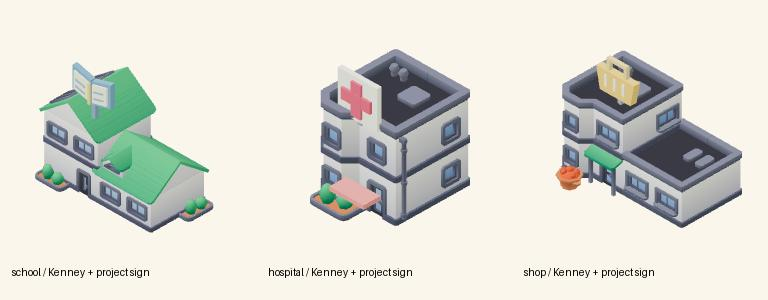

# Kenney 三件地标样板核对

2026-11-12，基线 `1d41862`。本项仅制作资产，集成映射、world 摆放和图标由主 Agent 负责。

已阅读并对照本地完整素材库的官方图片：

- City Kit (Suburban)：`/workspace/kenney-3d-library/2026-11-12/packs/city-kit-suburban/original/Preview.png`，[官方页面](https://kenney.nl/assets/city-kit-suburban)。绿坡顶、白墙、深蓝窗框、入口植物与原始模型截图相符。
- City Kit (Commercial)：`/workspace/kenney-3d-library/2026-11-12/packs/city-kit-commercial/original/Preview.png`，[官方页面](https://kenney.nl/assets/city-kit-commercial)。灰色平顶、奶白立面、蓝色玻璃、现有绿色店面雨篷与原始模型截图相符。

先将 Suburban a/b/d/g/h/m/p/q 和 Commercial c/e/a/d 的实际 GLB 从固定 (+X,-Z) 视角渲染为候选接触表，核对入口与轮廓后选择：

| 地点 | 实际 Kenney 主体 | 辨识轮廓/标识 | XYZ 尺寸（scale 1） |
| --- | --- | --- | --- |
| 学校 | Suburban `building-type-b` | 高低双坡顶；大蓝色打开书本、米色书页/阅读线、金色书脊 | 4.296 × 3.680 × 2.679 |
| 医院 | Commercial `building-c` | 紧凑两层平顶；大红十字立牌、小红色入口雨篷 | 2.916 × 4.040 × 3.779 |
| 商店 | Commercial `building-e` | 两层主楼+一层侧翼；原绿色入口雨篷；大橙色购物篮及真实 Mini 水果展示台 | 4.264 × 3.400 × 3.275 |

**医院/学校是本项目改造用途，本次选择的官方文件没有专用 hospital/school 语义。** 三栋原建筑的几何、材质、UV、纹理完整保留；没有再造整栋外壳。项目标识使用少量低面数平面挤出几何与纯色材质，保持原包的方正、低细节、玩具小镇比例。绿坡顶、平顶、阶梯侧翼提供三种不同轮廓。医院红/学校蓝/商店橙是新增大标识配色，未替换 Kenney 原墙/屋顶材质。

成果预览：

验证：使用实际 Babylon 图标渲染器短时加载三件组合 GLB并输出 `docs/previews/kenney/*-preview.png`；浏览器无 pageerror。已人工检查原建筑入口/屋顶保留、书本/十字/购物篮位于固定镜头可见正面、没有外部贴图请求。完整组合原点位于 XZ 中心、y 最小值 0；所有尺寸低于 4.8。主 Agent 已确认 `world` 对这三件使用 scale 1，其他旧地标可保持原比例。

脚本、原始输入、完整CC0许可证与分层hash记录随资产分发，支持离线重生成。当前验证为云端 Chromium 软件渲染，未验证 iPad 实机表现；全镇镜头辨识度由主 Agent 集成截图继续验收。
