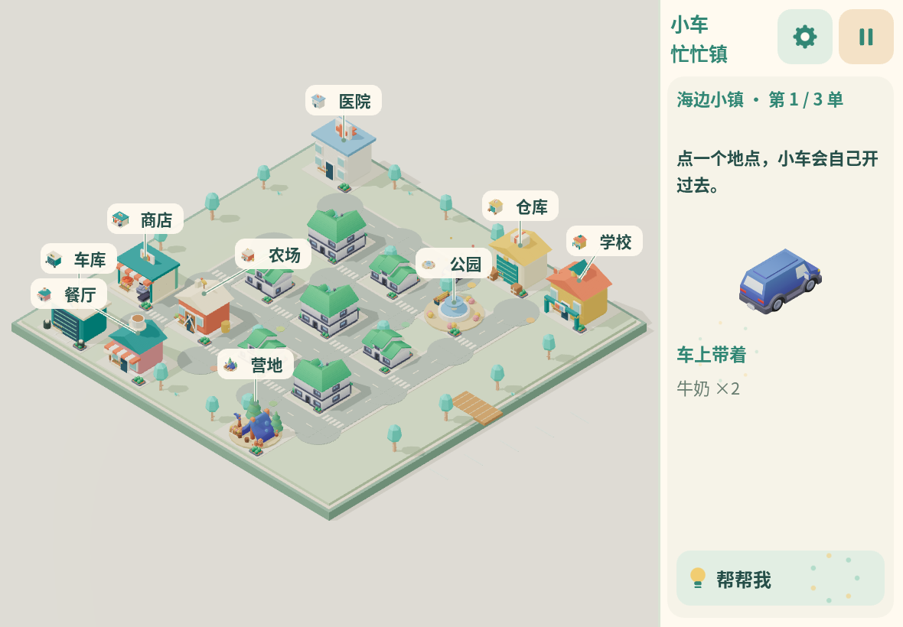
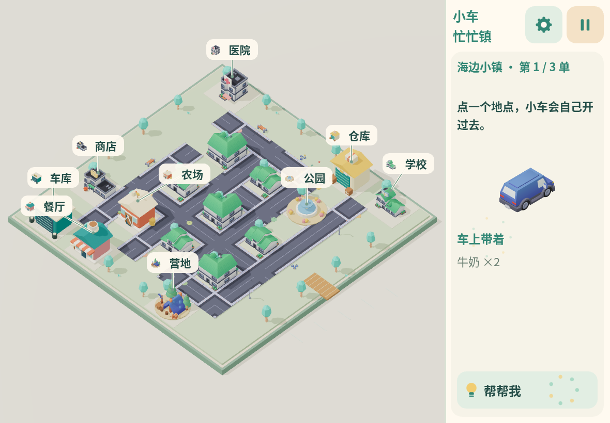

# Kenney 模型与官方画面对照

本轮目标：使用现成建筑、道路和街边设施，保留原始几何、色图及材质，再用少量大标识表达学校、医院和商店。核对日期：2026-11-12。

## 对照来源

以下是从官方资源页保存的原始预览，作为造型、配色、路缘和细节比例的依据；图片由Kenney提供，模型原始CC0许可随对应资源保存。

- [City Kit Roads 2.2](https://kenney.nl/assets/city-kit-roads)：[官方全件预览](previews/kenney/official-roads.png)。对照深灰路面、浅色路缘、路口标线和橙白施工设施。
- [City Kit Suburban 2.0](https://kenney.nl/assets/city-kit-suburban)：[官方全件预览](previews/kenney/official-suburban.png)。对照绿色坡顶、白墙、深色窗框与屋前花坛。
- [City Kit Commercial 2.1](https://kenney.nl/assets/city-kit-commercial)：[官方全件预览](previews/kenney/official-commercial.png)。对照低层楼的台阶体量、深色平顶和入口雨篷。
- [Coaster Kit 1.0](https://kenney.nl/assets/coaster-kit)：街边长椅和花卉，几何与原始色图保留。
- [Mini Shop 2.1](https://kenney.nl/assets/mini-shop)：商店门口果蔬道具，作为商业用途线索。

完整50包原档留在云端素材库 `/workspace/kenney-3d-library/2026-11-12/`；运行清单仅包含实际选择的资源。

## 判断标准

1. 模型能在官方预览与实际原文件中对应，来源记录包括原文件和分发SHA-256。
2. 原GLB材质不做统一金属度/粗糙度覆盖，各包色图保留并嵌入，防止同名colormap.png被互相替换。明确的兼容修正仅针对Nature Kit 2.1三件旧植被：源文件连树叶/树干都编码metallic=1，与官方哑光植被外观不同，因此运行时只将其metallic设为0，保留原色和粗糙度。
3. 固定镜头能看到入口与新增大标识，缩略图从同一最终GLB生成。学校为书本、医院为医疗图形、商店为购物篮，不只靠文字区分。
4. 道路形状反映真实连接，不给不存在的地图边开口；按实际占地拼接、检查接缝和车轮经过的位置。
5. 街边装饰稀疏摆放，不占车道、不盖住任务地点，不接收地图点击。
6. 地图、图鉴、装卸和任务全流程只使用已加载资源；换图销毁实例，保留共享资源。

官方预览采用不同背景、摆放和离线照明，不把像素完全一致作为承诺。游戏保持现有暖色沙盘和固定相机；比较的是模型轮廓、原始配色、材质关系和可读性。实际iPad屏幕上的显示效果仍需真机反馈。

## 实际截图与验证

开发过程的同种子前后截图、三主题配送和图鉴截图保存到 `artifacts/kenney/` 与 `artifacts/v2/`，不随游戏启动加载。最终选定截图随本页保存；验证以本轮实际执行记录为准。

### 同种子画面对比

改动前：

改动后（最终生产构建 index-Cfx3VQlw.js）：

复核结果：道路使用原包深灰铺面、浅色路缘及路口标线，保留连续路网；长椅、路灯、花卉和施工设施来自对应原包。三座样板保留原建筑轮廓和配色，仅添加可辨认的大标识。地图仍保留其他旧地标，尚未把所有原创建筑替换；这张图用于评估样板方向。植被按官方哑光外观做了明确、局部的材质兼容修正。

32项模型均可在设置→模型图鉴中查看，支持分类、来源说明和缩放。功能与资源验收见[验证记录](validation.md)。
