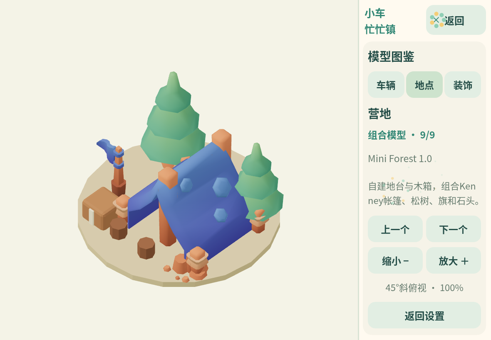

# 模型图鉴

在游戏中点击「设置 → 模型图鉴」。左侧显示实际预加载的3D模型，右侧选择车辆、地点、装饰，点击上一个/下一个切换，用放大/缩小调整大小。采用固定45°斜俯视，保留单个可见Canvas。查看时暂停任务，退出后保留货物、位置与进度；竖屏仍显示横置提示。

图鉴包含当前资源库的27个模型。每项展示来源类型、素材包和一句说明；完整映射由 `src/v2/model-catalog.js` 管理，并在构建检查中与资源清单核对。

| 来源类型 | 数量 | 内容 |
| --- | --- | --- |
| Kenney素材 | 11 | Car Kit的4辆车、Suburban的3种住宅与花盆、Nature的3种树木/灌木 |
| 项目自建 | 14 | 巴士、洒水车，仓库/公园/学校/医院/农场/餐厅/车库，住宅/圆树/灌木/长椅/花箱 |
| 组合模型 | 2 | 商店：自建外壳＋Mini Shop货架/商品/收银台；营地：自建地台/木箱＋Mini Forest帐篷/树/旗/石头 |

Kenney素材保留CC0许可；组合模型并非整件来自素材包，也不是整件原创。详见[资源来源](assets-and-licenses.md)。

车辆与地点图标由同一GLB烘焙，模型改变后必须重烘焙，构建通过SHA-256检查避免图标与实物分叉。图鉴只克隆已有资源，不再发起模型下载；退出、换模型时销毁预览实例，保留共享材质。

