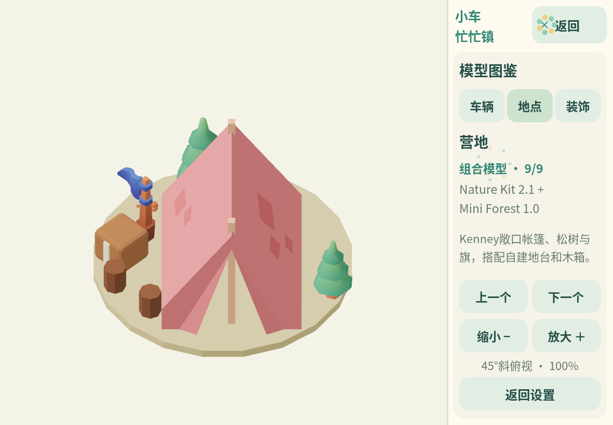

# 模型图鉴

在游戏中点击「设置 → 模型图鉴」。左侧显示实际预加载的3D模型，右侧选择车辆、地点、装饰，点击上一个/下一个切换，用放大/缩小调整大小。采用固定45°斜俯视，保留单个可见Canvas。查看时暂停任务，退出后保留货物、位置与进度；竖屏仍显示横置提示。

图鉴包含当前资源库的44个模型。每项展示来源类型、素材包和一句说明；完整映射由 `src/v2/model-catalog.js` 管理，并在构建检查中与资源清单核对。

| 来源类型 | 数量 | 内容 |
| --- | --- | --- |
| Kenney素材 | 35 | Car Kit的10辆车、Suburban的7种住宅与花盆、Nature的3种植被、道路与施工设施、街灯/长椅/花卉/纸篓/信号灯/路牌/围栏 |
| 项目自建 | 2 | 公园、农场 |
| 组合模型 | 7 | 仓库/学校/医院/餐厅/车库/商店采用Kenney建筑与项目或Kenney附加标识；营地组合Nature敞口帐篷、Mini Forest道具与项目地台 |

Kenney素材保留CC0许可；组合模型并非整件来自素材包，也不是整件原创。详见[资源来源](assets-and-licenses.md)。

车辆与地点图标由同一GLB烘焙，模型改变后必须重烘焙，构建通过SHA-256检查避免图标与实物分叉。图鉴只克隆已有资源，不再发起模型下载；退出、换模型时销毁预览实例，保留共享材质。

道路与路边模型位于“装饰”分类；图鉴展示实际预加载模型。未继续使用的旧原创住宅、圆树、灌木、长椅、花箱源文件保留，但不再启动加载或列入当前图鉴。新样板与官方对照见[视觉说明](kenney-visual-reference.md)。

新增车辆、住宅与道具的原包、运行尺寸、来源哈希及可复现导入方法见[Kenney小镇资源](kenney-town-assets.md)。旧巴士/洒水车和旧功能建筑文件只作历史源参考，不再作为当前相同ID的实际运行模型。
