# 小镇画面与交互修正记录（2026-11-13）

道路与侧栏初次候选为 `index-BNNQxIdb.js`，后续发现停车与组合模型问题后已继续修正；最终构建以验证记录为准，资源版本 `town-neighborhoods-2`。以下区分真实画面、几何检查与动态验收，不把任一种证据替代另一种。

## 道路：连接方向确实反了，不只是观感差异

旧代码把Babylon glTF左手转换误当成单独反射Z，实际loader组合Y半转和Z负缩放，结果反射X。直路和十字的对称性掩盖了错误，转角、T口与尽端因此朝错半圈，路缘封住实际连接的道路。旧测试重复了错误假设，不足以证明道路正确。

修正按实际加载后网格建立开口模板，弯道换用Kenney原版 `road-bend`。保持现有2.5米运动转弯半径，检查完整车身范围，而不是只检查车的中心点。直路细模块接边在近景可见，但此次未发现同类横向封路缺陷，不把非等比长度适配误认成已确认根因。

| 同一地点和镜头 | 修正前 | 修正后 |
| --- | --- | --- |
| 转角 | 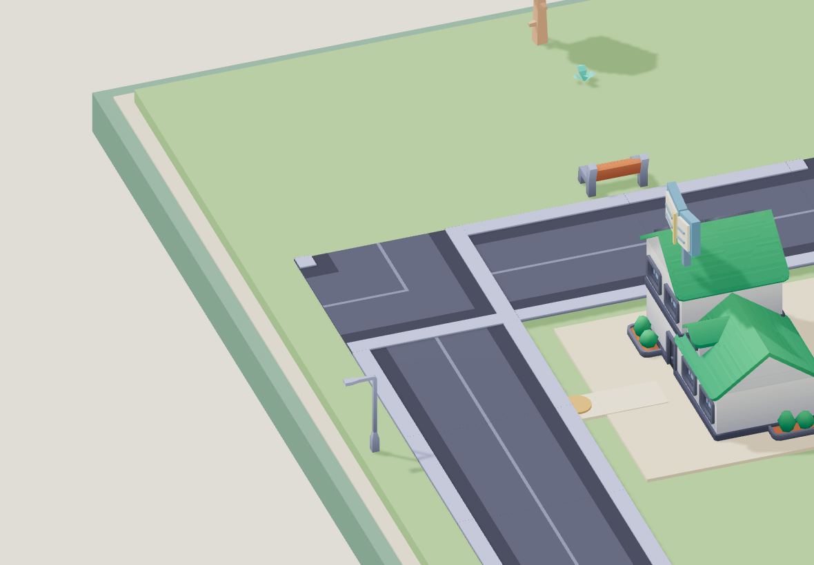 | 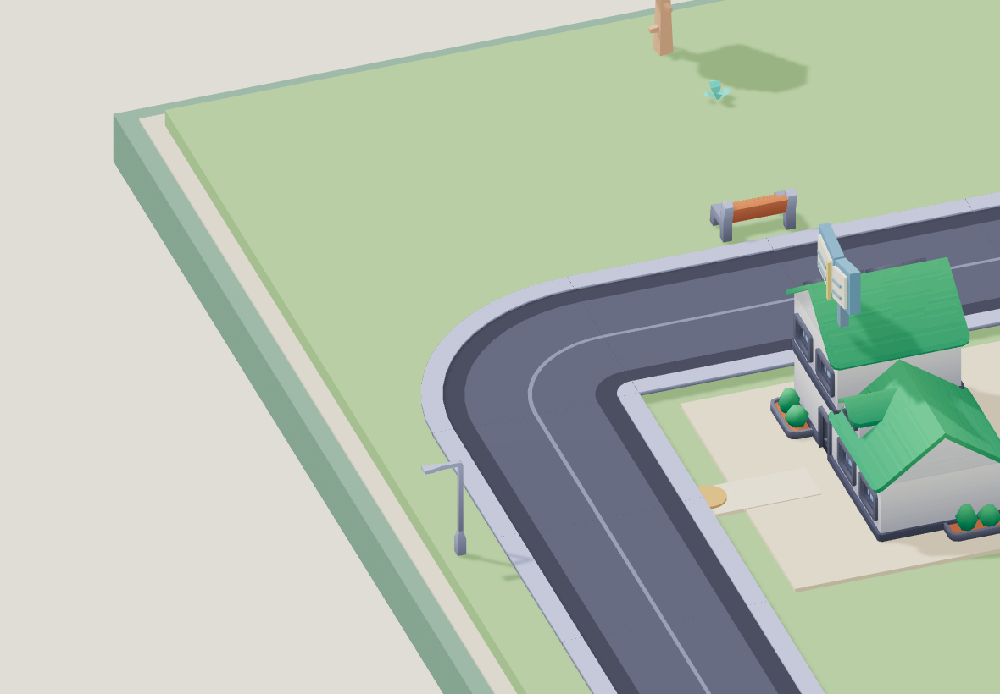 |
| T口 | 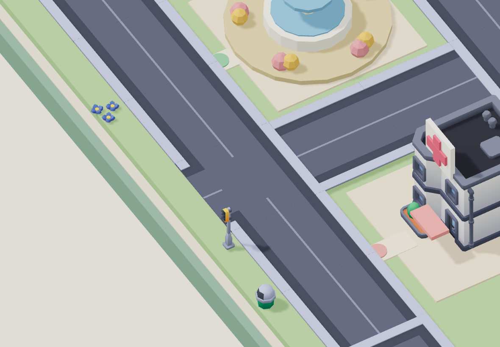 | 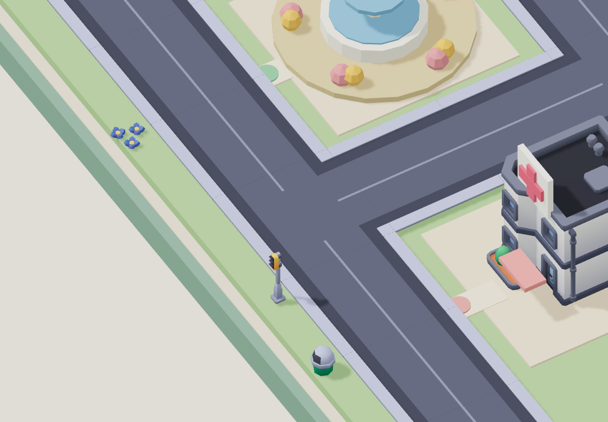 |
| 尽端 | 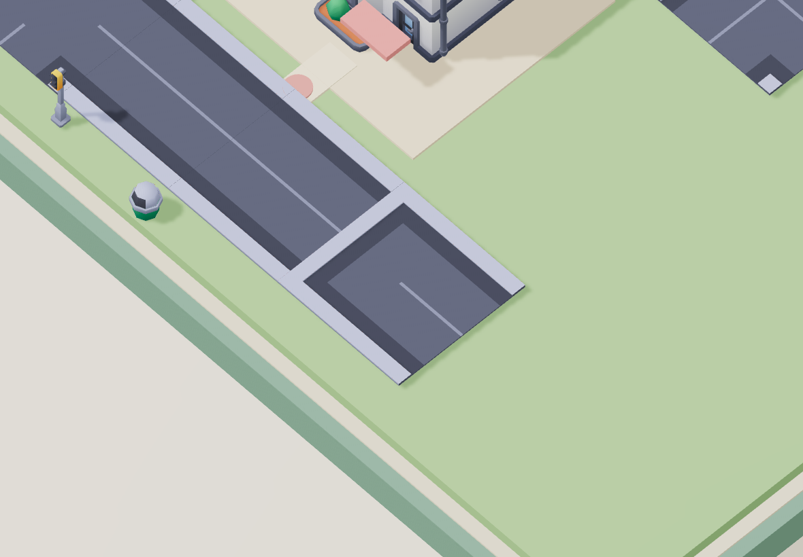 | 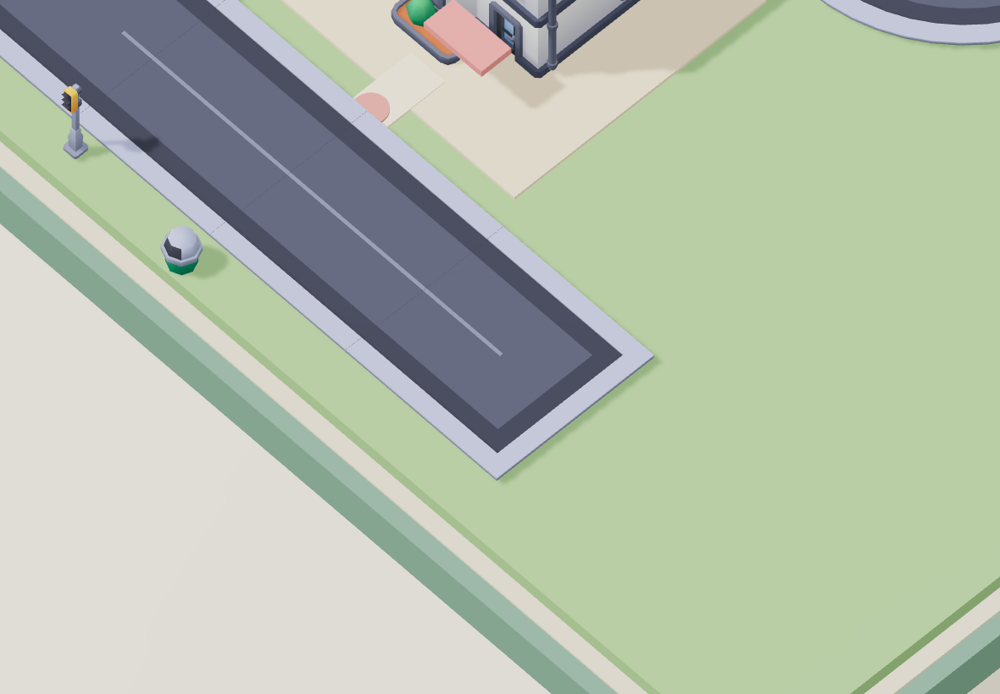 |

`tests/street-layout.test.js`使用真正的Babylon loader、源顶点和世界矩阵，核对15类节点连接、路面与路缘、铺路接缝以及最长车型的圆弧扫掠范围。Node检查只剥离材质/纹理引用以避免图片解码，几何与节点层次不变；真实颜色和显示另由浏览器验证。

## 标识：移到独立侧栏，让建筑完整露出来

此前9块白色文字牌即使避开红十字，仍会遮背景建筑，26px图标也不足以帮助儿童识别。该轮过松的视觉通过结论已撤回。

新方案默认地图无文字牌和引线。右侧一次显示9张实际模型卡，每张86×116逻辑像素，模型图72px、两字名称25px；点击卡或世界中的建筑均直接出发，不添加分页和确认。行驶、装货和交货继续使用各自面板。地图不再逐帧计算与排版标签，未删除阴影、模型或材质来换性能。

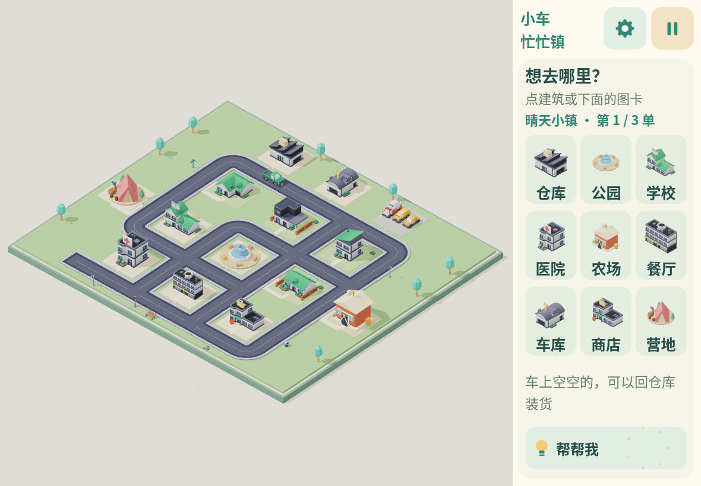

## 地图和素材

地图使用3类布局模板与约束随机，保留9任务地点、4块住宅和独立停车地块。草坪、院落、道路和入口步道保持清楚层次；学校、医院与商店提高相对住宅的体量。44个运行模型中35个Kenney资源、7个组合模型、2个项目自建模型；10种可选车及3辆停放车，详细来源见[资源扩展](kenney-town-assets.md)。

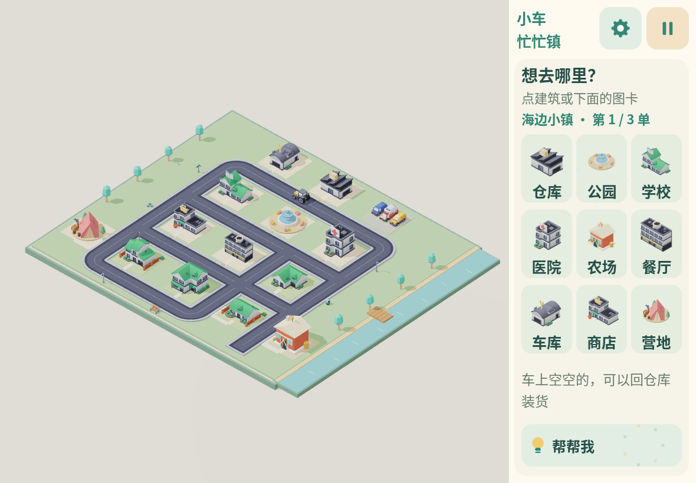
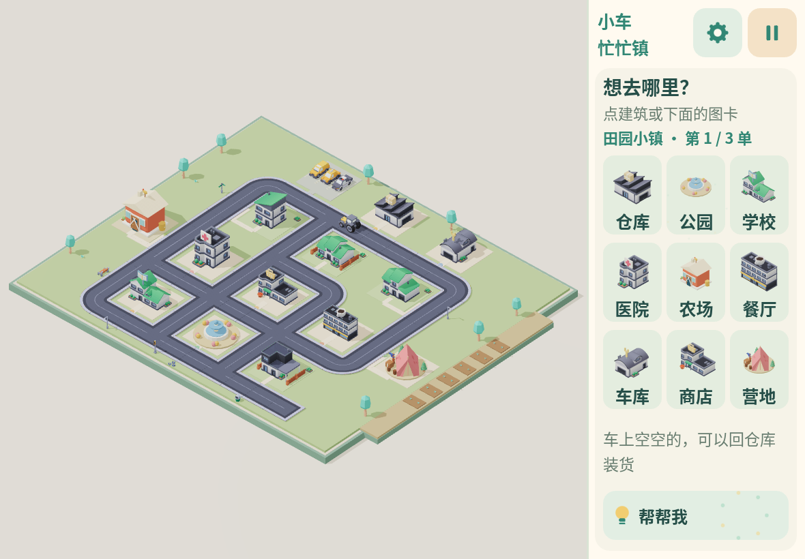
以上三图来自最终 D2ZvMdG2 构建的随机种子1325520887、3991073548、1931187974，分别覆盖garden-walk、market-lane、village-square，不沿用修正前模型截图。

正确loader重测200种子，实际建筑/住宅/停车车辆无地块越界，宽度计入的步道、低层植被和路边装饰无车道或入口侵占；围栏按真实三角形检查，中央空洞不误当成实心。32种子回归在`tests/world-placement.test.js`保留。

实际浏览器已通过20次新随机地图：覆盖3模板和3主题，9卡全部位于独立侧栏、互不重叠，建筑投影点不被UI目标盖住；左缘、右缘和中心的真实卡片点击命中正确目的地，准备好后断网无新增游戏资源请求。几何位置通过不等于每个建筑真实点击都通过，3种视口实际点建筑与配送已通过；新增27点专项本轮尚未执行，不能标为通过。

## 停车复审发现的新问题

原先路线以路口节点中心作为车辆最终位置。尽端冷藏车车头贴封边，最长消防车超出路块；实际三角形进一步证明部分圆弯节点停车时前轮压路缘。现由World将车辆停在入路口前3米的直路，逻辑任务地点不变。出发接续实际坐标，同边路线去掉多余节点，首尾路段保留完整转弯半径，换车保留朝向。

实际加载后的车身范围、路面和路缘验证覆盖10车型、连续任务和回仓库；初始停车/到达同步/暂停/图鉴另经小型集成探针验证。最终消防车实际配送与3种视口的完整任务已通过，医院停靠与交货专项已通过；未宣称10车型都已完成最终浏览器配送。起步180°原地缓慢调向仍可能车身外摆，不属于本轮完成的完整碰撞系统。

## 独立复审与边界

独立视觉Agent实际对照修复前后近景及三主题总览，确认上述道路封边和文字牌遮挡已消除。没有以“资源数量多”“测试全绿”代替观感判断，也没有将静态截图当作驾驶动画证明。

驾驶、到站、事件、全部车型、27处实际建筑点击、图鉴、方向保护与WebKit验收仍按最终[验证记录](validation.md)记录。原生iPad Air4/Safari安装、真实硬件帧率和儿童辨识/趣味性没有在云端得到证明。

用户随后指出组合模型拼接问题，逐件放大后确认遗漏，已单独重开[组合模型复查](model-quality-review.md)，不将本页的道路/侧栏结论扩展为所有模型合格。

最终候选D2ZvMdG2的消防车真实离线配送已通过，三张截图分别来自三个实际弯道；截图前后均处于moving且curvature非0，没有暂停摆拍或改变模拟时间。逐渲染帧最大朝向变化0.124rad，停在目的地节点前3米，随后实际完成交货。独立审查逐图确认轮胎/车身未见压路缘或草坪、无房树遮挡，停车在入口附近直道。

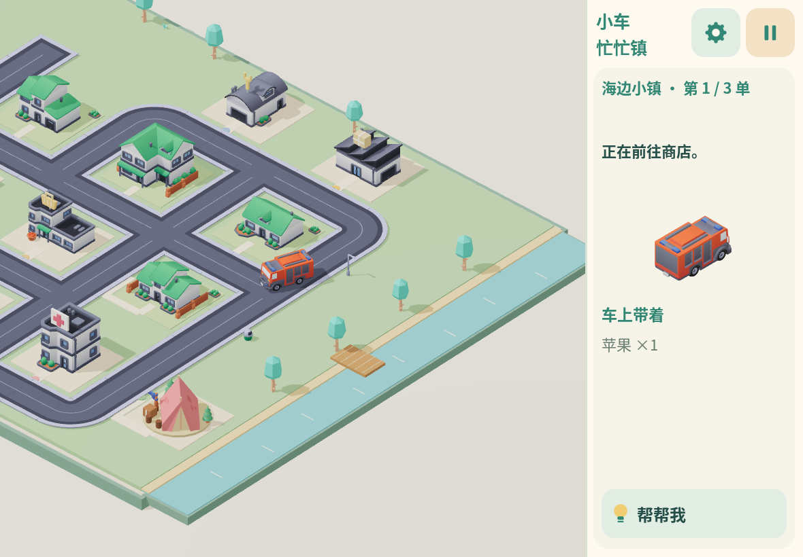
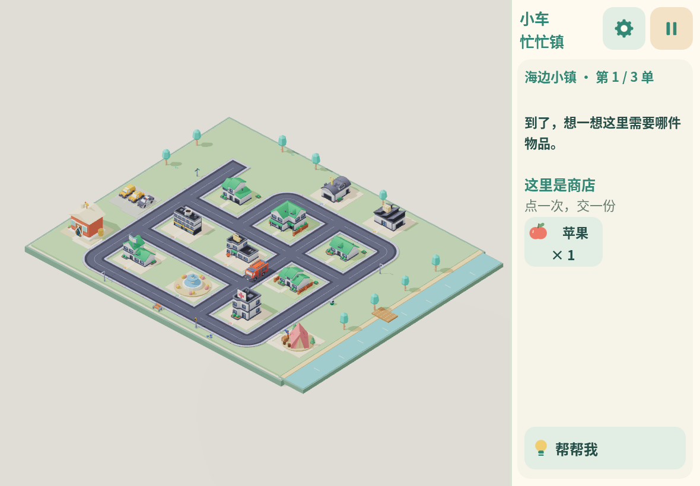

用户要求收尾后，最终构建仅继续医院停靠复核和发布后关键配送，不扩大为全量回归。独立复审看7件模型、6张不同随机图与3个真实弯道；已看范围未发现确定P1，P2包括商店水果盆偏大、学校与绿色住宅轮廓接近、道路细模块拼缝。完整证据与未执行专项见验证记录。

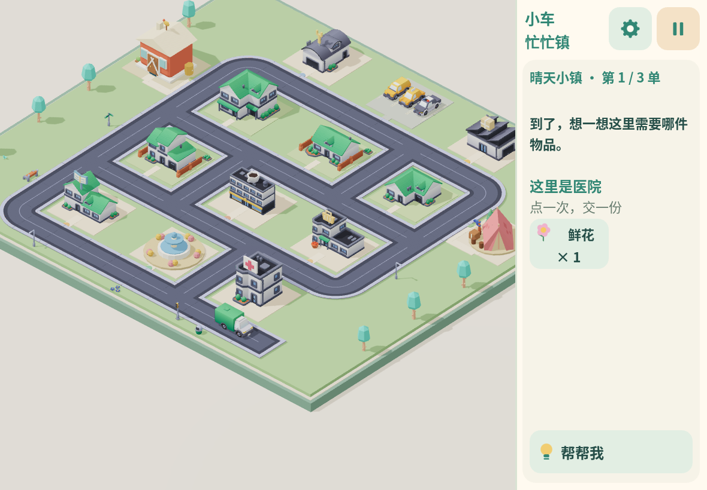
