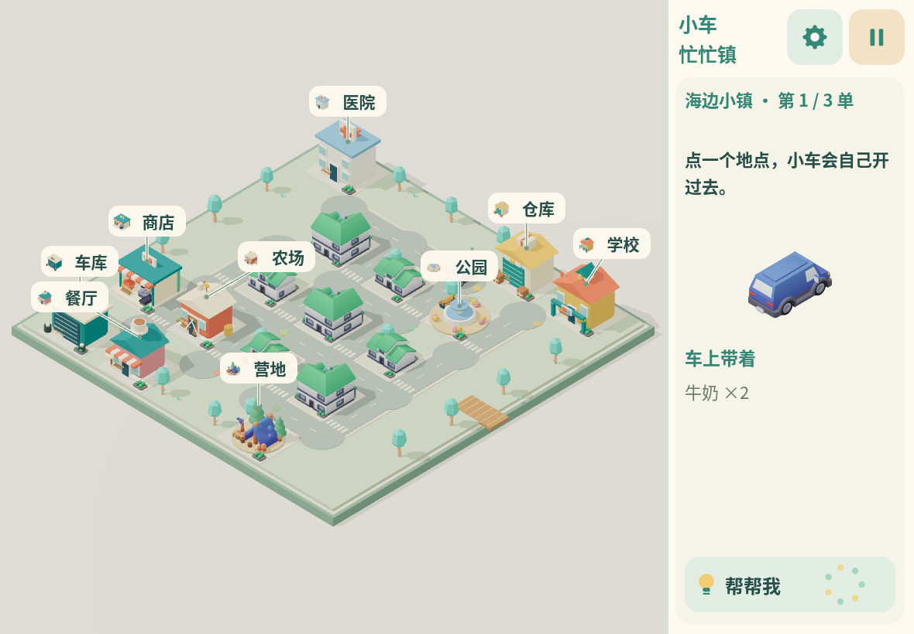
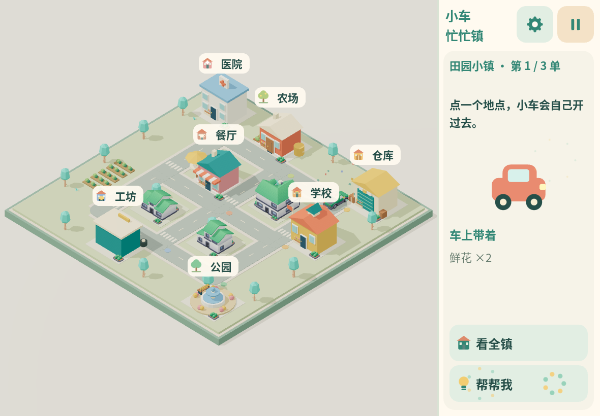

# 小车忙忙镇画面样板

2026-11-12，分支 `fix/town-visual-and-map-input`。以下是实际网页原型的浏览器截图，不是概念图或生成图。用户已要求将本样板合入 main 并直接发布到正式 Pages，供实际试玩比较。下方保留的是初次样板截图；后续版本在保持此画风的基础上加入右侧独立操作区及 iPad 安装适配，实际界面以线上最新版为准。用户澄清先前比较的是旧线上版，本轮不再迁移引擎或重做美术。

本轮先按用户反馈恢复玩具小镇的画面：暖色背景、柔和阴影、原始 PBR 材质；增加 Kenney 住宅、花箱和植被，补充人行横道；调整斜俯视角度、车辆尺寸、跟随镜头过渡和地点标牌。界面仍为全 Canvas，标签保持大点击范围，所有资源仍在开局前准备。

## 当前 Mini 地标与识别修复

当前版本增加4×4街区、商店与营地；任务建筑正面统一朝可见一侧，帐篷入口已校正，实际模型缩略图与两字名称一致。地点牌有对应引线并尽量避开其他建筑门面；后续自然沿路布局见[研究记录](isometric-readability-research.md)。本轮先保证建筑能够辨认，不扩大到新的街区生成方案。

设置内新增[模型图鉴](model-library.md)，展示当前27个实际模型的来源，并可固定45°斜俯视缩放。

## 上一版操作区布局

保留样板画风，左侧显示小镇，右侧依阶段显示任务、选车、装货、交货和帮助。下图为实际浏览器截图。

## 正式版调整前

## 样板小镇总览

## 到达餐厅

当前用于确认整体方向，尚非最终美术验收。真实 iPad Air 4 画面、手感与性能待真机验证；用户要求性能优化后置，先确认画面。截图环境为 1180×820 云端 Chromium 软件渲染。

复现：`npm run build` 后启动静态服务，运行 `python tests/v2_visual_preview.py`。它通过真实 Canvas 点击完成断网配送，并连续切换十张随机地图，验证没有旧场景残留网格或新增资源请求。地图建筑与标签的鼠标/触屏回归使用 `python tests/v2_map_input.py`。
