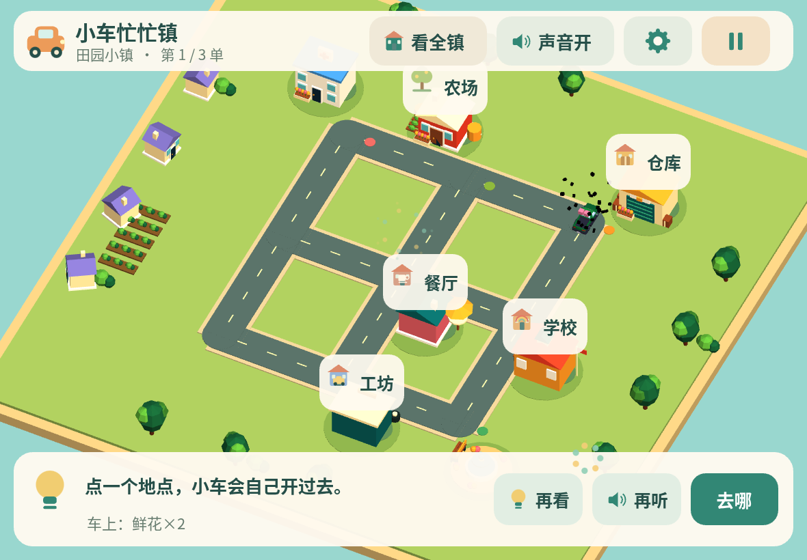
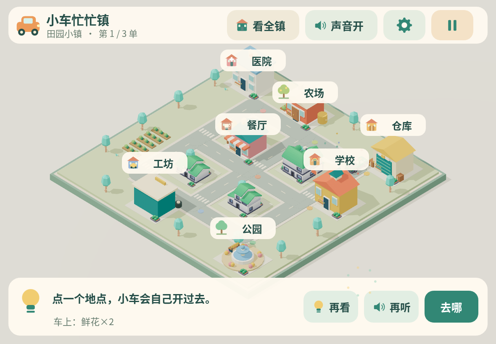
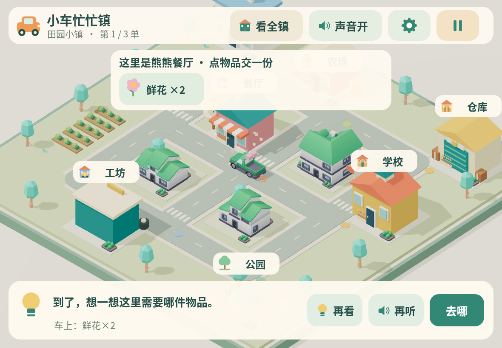

# 小车忙忙镇画面样板

2026-11-12，分支 `fix/town-visual-and-map-input`。以下是实际网页原型的浏览器截图，不是概念图或生成图。正式 Pages 已发布地点点击修复，暂未发布本视觉样板。

本轮先按用户反馈恢复玩具小镇的画面：暖色背景、柔和阴影、原始 PBR 材质；增加 Kenney 住宅、花箱和植被，补充人行横道；调整斜俯视角度、车辆尺寸、跟随镜头过渡和地点标牌。界面仍为全 Canvas，标签保持大点击范围，所有资源仍在开局前准备。

## 正式版调整前

## 样板小镇总览

## 到达餐厅

当前用于确认整体方向，尚非最终美术验收。真实 iPad Air 4 画面、手感与性能待真机验证；用户要求性能优化后置，先确认画面。截图环境为 1180×820 云端 Chromium 软件渲染。

复现：`npm run build` 后启动静态服务，运行 `python tests/v2_visual_preview.py`。它通过真实 Canvas 点击完成断网配送，并连续切换十张随机地图，验证没有旧场景残留网格或新增资源请求。地图建筑与标签的鼠标/触屏回归使用 `python tests/v2_map_input.py`。
